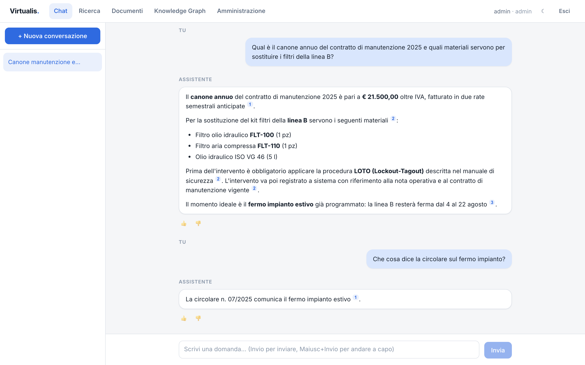
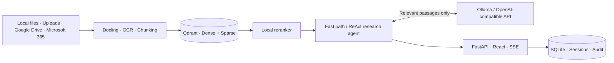

# Virtualis

Local-first agentic RAG for document intelligence, with verifiable citations and an auditable retrieval process.

[](https://github.com/mlaurelli/virtualis-rag/actions/workflows/ci.yml)
[](LICENSE)




## Overview

Virtualis lets users question a document collection in natural language and inspect exactly where an answer comes from. Citations link back to the source document, page, section and text passage; for PDFs, the built-in viewer opens the cited page and highlights the relevant layout region.

The system is designed for **on-premise deployment**. Documents, embeddings, indexes, reranking, chat history and audit logs can remain on the customer's infrastructure. Generation works with a local model through Ollama or with any OpenAI-compatible endpoint.

## What it demonstrates

- **Agentic retrieval:** a fast path for simple questions and a ReAct research loop with tool calling for multi-document questions.
- **Hybrid search:** dense and sparse retrieval in Qdrant, reciprocal-rank fusion and local cross-encoder reranking.
- **Grounded answers:** verified citation markers, adversarial critic, confidence signaling and one-shot reflexion for fragile answers.
- **Document ingestion:** PDF, DOCX, XLSX, PPTX, HTML, Markdown, text and images through Docling, with optional OCR.
- **Multiple sources:** local folders, direct uploads, Google Drive and Microsoft 365.
- **Product surface:** React frontend, SSE streaming, session history, direct search, user roles, feedback and audit trails.
- **Integrations:** OpenAI-compatible LLM client and an MCP server for document tools.

## Architecture



## Quick start

### Requirements

- Python 3.11 or 3.12 with [uv](https://docs.astral.sh/uv/)
- Node.js 20.19+ and npm
- Ollama for local generation, or an OpenAI-compatible provider
- Docker for the containerized deployment

### Development setup

```bash
cp .env.example .env
make setup
```

For a local Ollama model, set these values in `.env`:

```dotenv
MOONSHOT_API_KEY=ollama
KIMI_BASE_URL=http://localhost:11434/v1
KIMI_MODEL=qwen2.5:14b-instruct
KIMI_REASONING_EFFORT=
LLM_REQUEST_TIMEOUT=600
```

Then start the two development processes in separate terminals:

```bash
make dev-backend
make dev-frontend
```

The frontend is available at `http://localhost:5173`.

### Docker Compose

```bash
cp .env.example .env
docker compose up -d --build
docker compose exec ollama ollama pull qwen2.5:14b-instruct
```

The application is served at `http://localhost:8000`. Ollama is exposed only inside the Compose network; Qdrant runs embedded by default. The first run downloads several gigabytes of retrieval and generation models.

## Verification

```bash
make lint       # Ruff, mypy and oxlint
make test       # Backend unit and integration tests
make build      # Frontend typecheck and production build
make test-e2e   # Playwright against a real backend on isolated test data
```

The E2E suite covers authentication, chat and citations, feedback, document upload, indexing and hybrid search. External LLM calls are mocked in the backend suite; E2E tests use a real backend and an isolated data directory.

## Security and privacy

Virtualis includes JWT authentication, role-based administration, login throttling, security headers, optional TLS and response audit logs. Cloud credentials supplied for Microsoft 365 ingestion are used in memory and are not persisted by the application.

Local generation keeps prompts and retrieved passages on the local machine. Choosing a cloud generation provider explicitly sends the question and relevant passages to that provider; this distinction is documented and configurable.

### Current boundaries

This repository is a working prototype, not a claim of enterprise-ready high availability. In particular:

- deployment targets a single node;
- all authenticated users can access the indexed corpus; per-user ACL trimming from cloud sources is not implemented;
- source connectors are read-only;
- very large archives require dedicated sizing and operational engineering.

## Documentation

- [Technical documentation in Italian](doc/README.md)
- [API contract](backend/API.md)
- [Architecture](doc/01-architettura.md)
- [Security model](doc/06-sicurezza.md)
- [Demo guide](docs/DEMO.md)
- [Technical report](RELAZIONE.md)

## Contributing

Issues and pull requests are welcome. Run the complete lint, unit and build checks before submitting changes; add or update E2E coverage when changing user-facing behavior.

## License

Copyright 2026 Michele Laurelli.

Licensed under the [Apache License, Version 2.0](LICENSE).
