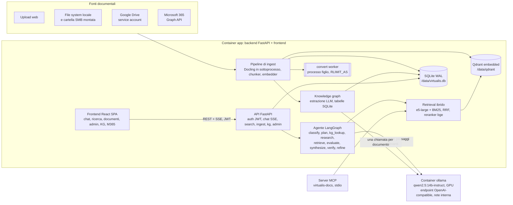
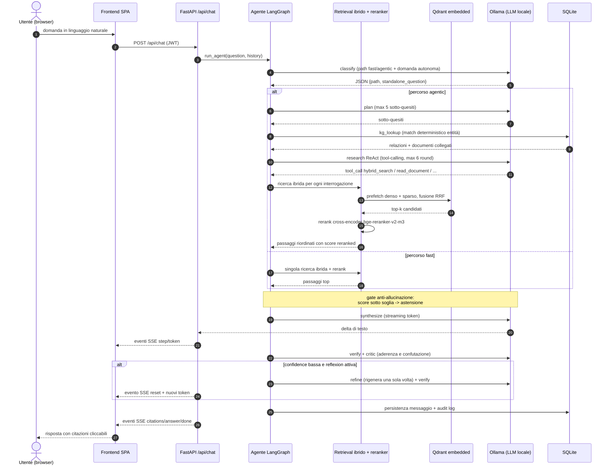
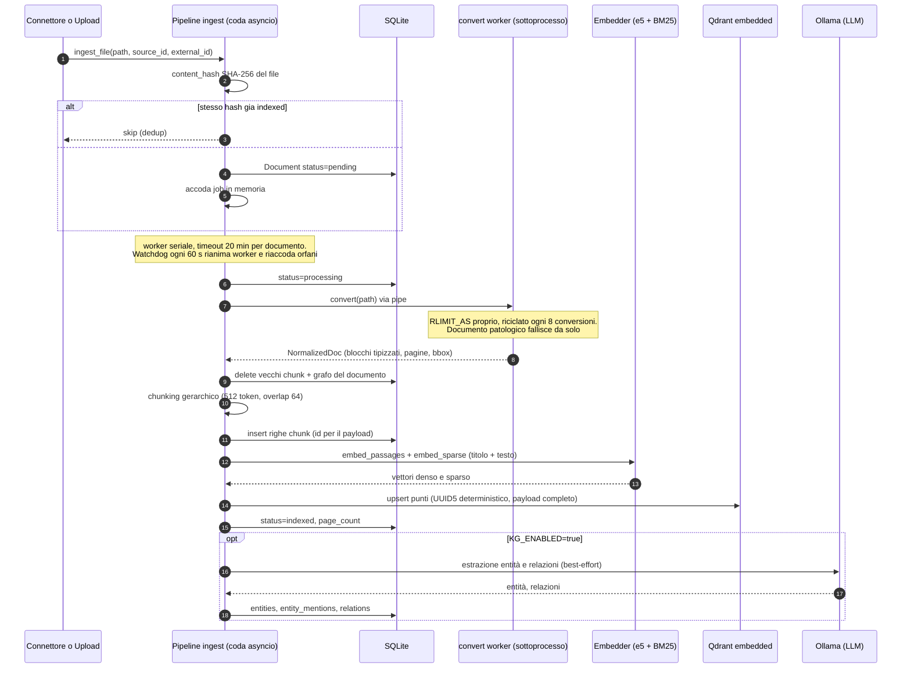

# 01 — Architettura del sistema Virtualis

Documento architetturale approfondito, derivato interamente da codice e
configurazione del repository. Ogni affermazione riporta il file di
riferimento. Documenti correlati: `README.md` (uso e setup),
`docs/ARCHITETTURA.md` (vista sintetica as-built) e `backend/API.md`
(contratto API).

---

## 1. Visione d'insieme

Virtualis è un sistema di **gestione e interrogazione documentale** basato su
RAG (*Retrieval-Augmented Generation*) **agentico**, progettato per girare
**interamente on-premise** presso il cliente (`README.md`).

### Cosa fa

- Indicizza documenti aziendali provenienti da quattro tipi di fonte: upload
  web, file system locale, Google Drive, Microsoft 365
  (`backend/app/models.py`, enum `SourceType`; a cui si aggiunge una
  cartella di rete SMB montata sull'host, vista come `local_fs`,
  `docker-compose.yml`).
- Permette di interrogare l'archivio in linguaggio naturale (italiano e
  inglese) via chat, con **citazioni verificabili** `[n]` collegate ai chunk
  e, per i PDF, apertura del documento alla pagina citata con il passaggio
  evidenziato tramite rettangoli di layout catturati da Docling a ingest
  (`README.md`, colonna `chunks.bboxes_json` in `backend/app/models.py`).
- Offre un percorso **fast** (singola ricerca puntuale) e un percorso
  **agentic** (scomposizione in sotto-quesiti, ricerche multiple, research
  agent ReAct con tool-calling, verifica e autocorrezione) selezionato dal
  nodo `classify` del grafo (`backend/app/agent/graph.py`).
- Mantiene cronologia delle sessioni, registro di **audit** delle risposte,
  feedback degli utenti e, opzionalmente, un **knowledge graph** di entità e
  relazioni usato attivamente nel ciclo agentico
  (`backend/app/models.py`, tabelle `audit_logs`, `feedback`, `entities`,
  `entity_mentions`, `relations`).

### Attori

- **Utente finale** (ruolo `user`): interroga via chat, usa la ricerca
  documentale diretta con filtri, consulta i documenti e le citazioni.
- **Amministratore** (ruolo `admin`): gestisce utenti e sorgenti, lancia
  import e sincronizzazioni, accede ad audit, feedback, healthcheck
  approfondito e pagina `/m365`. I ruoli sono modellati in
  `backend/app/models.py` (`UserRole.admin`/`user`) e fatti rispettare dai
  route (`require_admin` in `backend/app/auth.py`, usato ad es. in
  `backend/app/api/main.py` per `/api/health/deep`).
- **Agenti esterni**: gli strumenti documentali sono esposti anche come
  server **MCP** stdio (`virtualis-docs`, `backend/app/mcp_server.py`).

### Vincoli fondanti

1. **Nessun dato lascia la macchina.** Nella configurazione di produzione il
   LLM è locale via Ollama (`docker-compose.yml`: `KIMI_BASE_URL:
   http://ollama:11434/v1`), embedding e reranking girano in processo
   (`intfloat/multilingual-e5-large`, `Qdrant/bm25`,
   `BAAI/bge-reranker-v2-m3` in `backend/app/config.py`), indice vettoriale
   e database sono file locali (`Qdrant embedded` in `/data/qdrant`, SQLite
   in `/data/virtualis.db`). La porta di Ollama **non è pubblicata**:
   raggiungibile solo dentro la rete compose (`docker-compose.yml`,
   commento sul servizio `ollama`).
2. **Sostituibilità del modello.** Il client LLM
   (`backend/app/llm.py`, classe `KimiClient`) è un wrapper del SDK OpenAI:
   qualunque endpoint OpenAI-compatible (Ollama, vLLM, llama.cpp, API
   Kimi/Moonshot) funziona cambiando solo variabili d'ambiente
   (`KIMI_BASE_URL`, `KIMI_MODEL`, `MOONSHOT_API_KEY`).
3. **Degradazione elegante.** Ogni componente opzionale (reranker, OCR,
   knowledge graph, critic, HyDE, CRAG, reflexion) si disattiva via flag
   senza rompere il flusso principale (`backend/app/config.py`;
   graceful degradation esplicita in `backend/app/retrieval/rerank.py`).
4. **Ispezionabilità.** L'agente è un grafo di stati espliciti; ogni nodo
   appende uno *step* tracciato, esposto in streaming SSE e persistito in
   `audit_logs` (`backend/app/agent/graph.py`, `backend/app/models.py`).

---

## 2. Mappa dei componenti

### 2.1 Vista d'insieme

Riferimenti: struttura moduli in `README.md` (sezione "Struttura del
progetto"); wiring dei router in `backend/app/api/main.py`
(`create_app`); dipendenze Python in `backend/pyproject.toml`.

### 2.2 Backend (container `app`)

Moduli principali (`backend/app/`):

- **`api/`** — FastAPI: `auth`, `setup` (wizard primo avvio), `chat` (SSE),
  `search`, `docs`, `ingest`, `kg`, `m365`, `feedback`, `admin`, health
  (`backend/app/api/main.py:158-168`). Un middleware aggiunge gli header di
  sicurezza (CSP moderata, `nosniff`, `SAMEORIGIN`, …) a ogni risposta
  (`backend/app/api/main.py:124-149`). In produzione lo stesso processo
  serve il build React come SPA con fallback su `index.html`
  (classe `SPAStaticFiles`, `backend/app/api/main.py:99-108`).
- **`agent/`** — grafo LangGraph (`graph.py`), research agent ReAct
  (`research.py`), strumenti (`tools.py`), prompt (`prompts.py`), citazioni
  (`citations.py`).
- **`retrieval/`** — ricerca ibrida con fusione RRF nativa Qdrant
  (`hybrid.py`), reranker cross-encoder (`rerank.py`), servizio di ricerca
  condiviso (`service.py`).
- **`ingestion/`** — pipeline con coda asyncio e watchdog (`pipeline.py`),
  conversione Docling in sottoprocesso (`convert_worker.py` + `converter.py`),
  chunker gerarchico (`chunker.py`), embedding denso/sparso
  (`embeddings.py`), indice vettoriale Qdrant (`indexer.py`).
- **`knowledge/`** — estrattore entità/relazioni via LLM (`extractor.py`),
  query sul grafo (`query.py`).
- **`connectors/`** — contratto comune `enumerate/changes/fetch` (`base.py`)
  e implementazioni `local_fs`, `upload`, `gdrive`, `m365`.
- **`llm.py`** — client OpenAI-compatible con semaforo globale di
  concorrenza, retry con backoff+jitter e distinzione errori
  transitori/permanenti.
- **`mcp_server.py`** — server MCP stdio `virtualis-docs`.
- **`m365_import.py`**, **`reindex.py`** — job applicativi di lunga durata
  (import Microsoft 365, re-indicizzazione).

### 2.3 Frontend

SPA React 18 + TypeScript, build Vite (`frontend/package.json`). Pagine
(`frontend/src/pages/`): `ChatPage` (SSE, citazioni, badge affidabilità),
`SearchPage`, `DocumentsPage`, `KgPage` (grafo con `d3-force`),
`AdminPage`, `M365Page`, `ViewerPage` (PDF via `pdfjs-dist` con
evidenziazione del passaggio), `LoginPage`, `SetupPage` (wizard primo
avvio). In produzione è servita dal backend stesso (`FRONTEND_DIST`,
`backend/app/config.py:132`), in sviluppo dal dev server Vite con proxy
`/api` (`README.md`).

### 2.4 Ollama (LLM locale)

Container separato (`docker-compose.yml`): immagine `ollama/ollama`,
modello `qwen2.5:14b-instruct`, GPU NVIDIA riservata via
`deploy.resources.reservations.devices`, healthcheck TCP su 11434. Il
backend lo raggiunge come endpoint OpenAI-compatible
`http://ollama:11434/v1`; `app` parte solo a Ollama sano
(`depends_on: condition: service_healthy`).

### 2.5 Qdrant embedded e SQLite

- **Qdrant embedded**: `qdrant-client` in modalità locale dentro il
  processo backend, dati in `DATA_DIR/qdrant` (`backend/app/config.py:52`,
  `docker-compose.yml` `QDRANT_URL: ""`). Collezione unica `chunks` con
  vettore denso nominato `dense` e sparso `sparse` (modificatore IDF)
  (`backend/app/ingestion/indexer.py:32-33,116`). Point ID = UUID5
  deterministico da `(document_id, ord)`: upsert idempotenti
  (`backend/app/ingestion/indexer.py:29-37`).
- **SQLite** (async via aiosqlite/SQLAlchemy, `backend/app/db.py`):
  utenti, sorgenti, documenti, chunk, sessioni e messaggi chat, feedback,
  audit log, e le tre tabelle del knowledge graph
  (`backend/app/models.py`).

---

## 3. Diagrammi di sequenza

### 3.1 Domanda RAG (percorso agentic, `AGENT_MODE=react`)

Basato su `backend/app/agent/graph.py` (nodi e routing in
`build_graph`, linee 1336-1385) e `backend/app/llm.py`.

### 3.2 Ingest di un documento

Basato su `backend/app/ingestion/pipeline.py` (docstring di modulo e
`_process`, linee 186-352) e `backend/app/ingestion/convert_worker.py`.

---

## 4. Scelte architetturali e perché

Ogni voce cita il file (e, dove rilevante, l'incidente documentato nei
commenti del codice o del compose) che l'ha motivata.

### 4.1 Qdrant embedded invece di un server vettoriale separato

- **Scelta**: `QDRANT_URL` vuoto → client Qdrant in modalità embedded, dati
  in `/data/qdrant` dentro il volume `./data` (`docker-compose.yml:61-63`,
  `backend/app/config.py:52`).
- **Perché**: nessun server vettoriale separato da deployare e monitorare,
  nessuna porta extra esposta, backup unico della directory dati
  (`README.md`, sezione backup). La fusione RRF è nativa di Qdrant e
  funziona anche in embedded (`backend/app/retrieval/hybrid.py:1-11`).
- **Trade-off**: l'embedded **non tollera accessi concorrenti**: tutte le
  operazioni passano sotto un unico `asyncio.Lock` e in
  `asyncio.to_thread` perché il client è sincrono
  (`backend/app/ingestion/indexer.py:60`, `backend/app/retrieval/hybrid.py:8-11`).
  Il lock Qdrant può inoltre confliggere con un secondo processo che apra
  lo stesso storage (noto negli script di eval, `AGENTS.md`). L'opzione
  server esterno resta disponibile via `QDRANT_URL` senza cambi di codice.

### 4.2 `qwen2.5:14b-instruct` invece di modelli "reasoning"

- **Scelta**: modello di generazione `qwen2.5:14b-instruct` servito da
  Ollama (`docker-compose.yml:67-69`).
- **Perché**: sta interamente nei 16 GB di VRAM della GPU del cliente
  (100% GPU, ~82-104 token/s) e **non ha thinking**; i modelli reasoning
  (qwen3 ibrido, gpt-oss) funzionano ma il thinking non è disattivabile
  via endpoint OpenAI-compatible e allunga sensibilmente ogni passaggio
  della pipeline — e la pipeline agentica fa molte chiamate per domanda
  (`docker-compose.yml:2-7`, `README.md:45-48`).
- **Trade-off**: qualità di sintesi inferiore a un modello di frontiera;
  mitigata dalle soglie anti-allucinazione, dalla critic e dalla reflexion
  (§4.8). Salita di taglia possibile su GPU con più VRAM cambiando solo
  `KIMI_MODEL` (`README.md`).

### 4.3 `OLLAMA_CONTEXT_LENGTH=16384` e `SYNTHESIZE_MAX_CONTEXT_TOKENS=10000`

- **Scelta**: contesto Ollama fissato a 16384 token con slot singolo
  (`OLLAMA_NUM_PARALLEL=1`) e budget di sintesi a 10000 token
  (`docker-compose.yml:14-20,80-83`; `backend/app/config.py:90-94`).
- **Perché**: col default di Ollama (4096 diviso su 2 slot, ~2048 token
  per richiesta) i prompt RAG col corpus reale — che superano i 10k token
  — venivano **troncati** e il modello rispondeva fuori tema (incidente
  descritto nel commento del compose). 16k con slot singolo implica una KV
  cache di ~3 GB, che sta in VRAM assieme al modello (9,5 GB su 16 GB).
  Il budget di sintesi a 10000 lascia spazio a prompt di sistema, storia,
  contesto KG e margine di generazione dentro i 16k.
- **Trade-off**: nessun parallelismo lato Ollama (richieste in serie) —
  accettato e gestito a monte dal semaforo applicativo (§4.7); i passaggi
  oltre budget sono tagliati prima della chiamata (meno contesto in
  sintesi su corpora molto ricchi).

### 4.4 Conversione Docling in sottoprocesso con `RLIMIT_AS`

- **Scelta**: la conversione Docling gira in un processo figlio persistente
  (context `spawn`, comunicazione via `Pipe`) con limite di memoria proprio
  (`backend/app/ingestion/convert_worker.py`, docstring di modulo;
  `convert_in_subprocess=true` default in `backend/app/config.py:140-145`).
- **Perché**: alcuni documenti patologici (planimetrie raster, PDF enormi)
  superavano il `mem_limit` del container e l'OOM killer del cgroup
  uccideva l'**intero processo dell'app**, abbattendo i job in corso
  (import M365, code) — tre incidenti al 24/08. Col sottoprocesso il
  documento patologico fallisce **da solo** (status `failed`, "limite di
  memoria superato") e l'app resta in piedi.
- **`CONVERT_MAX_MEMORY_MB=24576`** (compose): `RLIMIT_AS` limita lo spazio
  di indirizzamento (VAS), non l'RSS; torch+Docling coi modelli di
  layout/OCR caricati superano i 16 GB di VAS anche su scansioni piccole e
  a 16384 fallivano con `std::bad_alloc` (`docker-compose.yml:72-75`).
- **Trade-off**: `spawn` + processo persistente (niente fork con asyncio,
  niente reload dei modelli a ogni documento); il figlio è **riciclato
  ogni `CONVERT_WORKER_MAX_TASKS=8` conversioni** perché torch/Docling non
  restituiscono la RSS al sistema e sotto carico il container andava
  contro il `mem_limit` (malloc nativi falliti, coda ingest morta il 26/08
  sera — `backend/app/config.py:146-150`, `docker-compose.yml:76-79`). Il
  costo del riciclo è il reload dei modelli una volta ogni 8 documenti.

### 4.5 `mem_limit` dei container dimensionato sugli incidenti OOM

- **Scelta**: `app` a 20 GB, `ollama` a 10 GB su host da 30 GB
  (`docker-compose.yml:13,51`).
- **Perché**: il processo principale tiene ~6 GB fissi (modelli di
  retrieval + Qdrant embedded; ~12,4 GB osservati a regime) e **gonfia
  durante l'ingest** perché gli allocatori torch/onnx non rilasciano:
  osservato a 15,7 GB dopo pochi documenti il 27/08. A 16 GB i malloc
  nativi fallivano (`std::bad_alloc`, "DefaultCPUAllocator: can't allocate
  memory") e la coda moriva in silenzio. Ollama è sceso da 14 a 10 GB
  (uso reale ~8 GB) per lasciare margine ad `app`
  (commenti in `docker-compose.yml:10-12,46-50`).
- **Trade-off**: tetto prudente ma non eliminabile finché gli allocatori
  nativi non rilasciano; la coppia riciclo-del-worker + mem_limit alto è
  la mitigazione corrente, con la profilazione della crescita RSS in
  backlog (`AGENTS.md`).

### 4.6 SQLite in WAL con foreign keys spente

- **Scelta**: `PRAGMA journal_mode=WAL`, `busy_timeout=5000`,
  `synchronous=NORMAL` su ogni connessione
  (`backend/app/db.py:21-39`).
- **Perché**: WAL consente letture e scritture concorrenti senza blocchi
  reciproci — essenziale con worker di ingestion e API sulla stessa base;
  `busy_timeout` evita "database is locked" immediati; `synchronous=NORMAL`
  riduce gli fsync ed è sicuro in combinazione con WAL.
- **Foreign keys volutamente OFF**: il modello dati conserva per design
  riferimenti "penzolanti" — audit log e feedback devono sopravvivere alla
  cancellazione di sessioni e messaggi (docstring in
  `backend/app/db.py:30-33` e di `Feedback` in
  `backend/app/models.py:162-169`).
- **Trade-off**: nessuna integrità referenziale enforced dal DB (affidata
  al codice); schema evoluto con `create_all` + **ALTER additivi**
  applicati all'avvio (es. `chunks.bboxes_json`), senza migrazioni dati
  (`backend/app/db.py:67-95`). Adeguato a nodo singolo; non a un
  deployment multi-istanza.

### 4.7 Semaforo globale `LLM_MAX_CONCURRENCY`

- **Scelta**: un `asyncio.Semaphore` globale (default 2) attraversato da
  **ogni** chiamata al modello, streaming incluso per l'intera durata
  dello stream (`backend/app/llm.py:33-48,326-337`;
  `backend/app/config.py:41-44`).
- **Perché**: Ollama serve le richieste in serie (e qui è configurato con
  `OLLAMA_NUM_PARALLEL=1`): accodare a monte evita che un job lungo (es.
  l'estrazione KG, una chiamata per documento) saturi il provider e
  affami la chat. Il semaforo è tenuto per tutto lo stream perché verso
  un provider seriale lo slot è occupato finché il modello genera.
- **Trade-off**: latenza di coda per richieste concorrenti oltre il tetto;
  nessun rischio di deadlock perché l'agente fa chiamate sequenziali, mai
  annidate (invariante documentata in `backend/app/llm.py:36-37`).

### 4.8 Anti-allucinazione: soglie di pertinenza sugli score del reranker

- **Scelta**: `RETRIEVAL_MIN_SCORE=0.15` e `RETRIEVAL_STRONG_SCORE=0.60`
  applicate **solo** a score effettivamente rerankati
  (`backend/app/config.py:58-69`; flag `reranked` su `SearchResult` in
  `backend/app/retrieval/hybrid.py:110-114` e `rerank.py:126-130`).
- **Perché**: gli score RRF grezzi vivono su un'altra scala (~0.01-0.03)
  mentre il cross-encoder produce una sigmoid in [0,1]: mescolarli rende
  le soglie insensate. Sotto la soglia minima l'agente **si astiene**
  invece di generare. Il default 0.15 è calibrato sul corpus reale
  (26/08): i documenti pertinenti stanno a ~0.2-0.5, quelli fuori tema
  sotto 0.1; il valore precedente 0.30 provocava over-astensione su
  domande brevi (commento in `backend/app/config.py:65-68`).
- **Trade-off**: la qualità del gate dipende dal reranker; se il reranker
  non è disponibile (graceful degradation) il gate non ha score rerankati
  su cui operare e il flusso prosegue con l'ordine RRF.

### 4.9 Reranker cross-encoder come parte del percorso standard

- **Scelta**: `BAAI/bge-reranker-v2-m3` via sentence-transformers, lazy e
  singleton, attivo di default (`RERANKER_ENABLED`,
  `AGENT_RERANK_ENABLED`; `backend/app/retrieval/rerank.py`).
- **Perché**: il reranking valuta la coppia (query, titolo + **testo del
  chunk**) — esattamente il passaggio citabile, non la finestra estesa che
  può includere contenuto adiacente fuori tema e gonfiare lo score
  (`backend/app/retrieval/rerank.py:104-115`). È anche ciò che rende
  possibili le soglie di §4.8.
- **Trade-off**: ~1-2 GB di modello e latenza aggiunta per ricerca;
  caricamento fallito o flag spento → risultati inalterati, mai errore.

### 4.10 Grafo a stati espliciti + research agent ReAct con fallback

- **Scelta**: LangGraph con nodi espliciti; sul percorso agentic
  `AGENT_MODE=react` sostituisce `retrieve`/`evaluate` con un loop ReAct a
  tool-calling (max `REACT_MAX_ROUNDS=6`)
  (`backend/app/agent/graph.py:1336-1385`, `backend/app/agent/research.py`,
  `backend/app/config.py:102-108`).
- **Perché**: ispezionabilità e audit di ogni passo; il tool-calling dà
  autonomia di ricerca sulle domande multi-documento, ma se fallisce
  (tool_call malformati per 2 round consecutivi o eccezione) il grafo
  **ripiega automaticamente** sul ciclo classico (`README.md`, sezione v2).
  Valori ignoti di `AGENT_MODE` ripiegano su `graph`
  (`backend/app/config.py:176-184`).
- **Trade-off**: il ReAct moltiplica le chiamate LLM per domanda (fino a 6
  round + strumenti) su un modello seriale; compensato da semaforo (§4.7)
  e ricerche parallele nel nodo `retrieve`
  (`RETRIEVE_MAX_CONCURRENCY=3`, `backend/app/config.py:126-128`).

### 4.11 Pipeline di ingest seriale con coda in memoria + watchdog

- **Scelta**: coda asyncio in-process, un solo worker, timeout di 20 minuti
  per documento, watchdog ogni 60 secondi
  (`backend/app/ingestion/pipeline.py`).
- **Perché**: la serialità semplifica la gestione della memoria (un solo
  convert worker, §4.4) e del lock Qdrant (§4.1). La coda in memoria si
  svuota a ogni riavvio: `resume_interrupted` riaccoda i `pending`, marca
  `failed` i `processing` interrotti e i `pending` il cui file non esiste
  più (così la sync della sorgente li riscarica), e **non** riaccoda mai i
  `failed` all'avvio — un lotto di fallimenti sistematici rilavorato a
  ogni riavvio brucerebbe ore (docstring di `resume_interrupted`,
  `pipeline.py:561-581`).
- **Watchdog** (nato dall'incidente 26-27/08, coda congelata due volte con
  decine di pending e worker morto in silenzio): rianima il worker se
  morto loggando la causa; se una lavorazione supera il **doppio** del
  timeout (il `wait_for` non è scattato: loop bloccato altrove) cancella e
  ricrea il worker marcando il documento `failed`; riaccoda i `pending`
  orfani senza job in memoria, ma solo dopo **due giri consecutivi** di
  conteggio anomalo per non duplicare un job nella finestra tra scrittura
  DB e accodamento (`pipeline.py:412-508`).
- **Trade-off**: throughput di un documento alla volta; lo shutdown non
  attende lo svuotamento della coda (con migliaia di documenti un
  `queue.join()` terrebbe in vita il processo per ore fino al SIGKILL —
  docstring di `stop_worker`, `pipeline.py:532-539`).

### 4.12 Knowledge graph su SQLite, best-effort, match deterministico

- **Scelta**: entità/relazioni in tabelle SQLite (`entities`,
  `entity_mentions`, `relations`), estrazione via LLM (una chiamata per
  documento, testo troncato a `KG_MAX_CHARS_PER_DOC=12000`), flag
  `KG_ENABLED` default off (`backend/app/models.py:206-266`,
  `backend/app/config.py:75-86`).
- **Perché**: zero dipendenze (niente Neo4j), stesso file di backup,
  scala adeguata al prototipo. L'estrazione è sempre **best-effort**: un
  fallimento non blocca mai ingest né ricerca
  (`backend/app/ingestion/pipeline.py:307-328`). Nel ciclo agentico il nodo
  `kg_lookup` fa **match deterministico** case-insensitive su parola
  intera (nomi ≥ 4 caratteri) — zero chiamate LLM aggiuntive, niente
  deriva di naming, testabile — e usa il grafo come *guida non citabile*:
  le affermazioni fattuali restano ancorate ai passaggi `[n]`
  (`README.md`, sezione GraphRAG; `backend/app/agent/graph.py:550`).
- **Trade-off**: costo LLM a ingest (dichiarato); il grafo aiuta i quesiti
  multi-documento ma non sostituisce il retrieval vettoriale.

### 4.13 TLS self-signed gestito dall'applicazione

- **Scelta**: HTTPS attivato valorizzando `TLS_CERT_FILE`/`TLS_KEY_FILE`;
  uvicorn parte in HTTPS se entrambe sono impostate, altrimenti HTTP, con
  errore esplicito se ne è impostata una sola (`backend/app/__main__.py`,
  `backend/app/config.py:163-166`). Certificato generabile con
  `backend/scripts/gen_cert.py` (SAN: hostname, localhost, IP LAN).
- **Perché**: il backend parla direttamente ai browser della LAN senza
  reverse proxy: TLS dentro il processo è il minimo per documenti
  riservati (`README.md`, sezione HTTPS su LAN).
- **Trade-off**: cert self-signed → eccezione di sicurezza nei browser (o
  distribuzione come CA fidata via GPO/MDM).

---

## 5. Flussi dati

### 5.1 Ingest: dalla fonte all'indice

Sequenza completa (vedi diagramma §3.2), con i punti di persistenza
(`backend/app/ingestion/pipeline.py`):

1. **Registrazione**: il connettore o l'upload chiama `ingest_file`;
   SHA-256 del contenuto → dedup (stesso hash già `indexed` → skip).
   `Document(status=pending)` su SQLite e job nella coda in memoria.
2. **Conversione**: Docling nel sottoprocesso produce un `NormalizedDoc`
   (blocchi tipizzati heading/paragrafo/tabella/elenco con `section_path`,
   pagina e bbox). Con `OCR_ENABLED=true`, se il testo medio per pagina
   scende sotto 100 caratteri (tipico delle scansioni) il PDF è
   riconvertito integralmente con Tesseract ita+eng (`README.md`, sezione
   OCR).
3. **Pulizia**: cancellazione dei vecchi chunk del documento (DB e
   indice) e del suo grafo, prima del re-ingest.
4. **Chunking gerarchico**: confini di sezione, target 512 token con
   overlap 64 (`CHUNK_TARGET_TOKENS`/`CHUNK_OVERLAP_TOKENS`),
   `context_text` (finestra estesa), bbox serializzati in
   `chunks.bboxes_json`.
5. **Embedding**: il testo embeddato antepone il **titolo del documento**
   (`build_passage_text`), così i chunk "muti" (es. tabelle di soli MAC
   address) restano agganciati al loro contesto anche in BM25; payload
   Qdrant e DB conservano il testo pulito. E5 richiede i prefissi
   `passage: `/`query: ` (`backend/app/ingestion/embeddings.py:29-30,84`).
6. **Upsert Qdrant**: punti con UUID5 deterministico e payload completo
   (metadati + bbox) → re-ingest idempotente.
7. **Commit**: `status=indexed` con `page_count`; se `KG_ENABLED`,
   estrazione entità/relazioni best-effort.
8. **Fallimenti**: qualunque eccezione → `status=failed` con messaggio
   pubblico sanitizzato (`_public_error`: solo le eccezioni di dominio
   espongono il dettaglio; le altre diventano "Errore interno durante
   l'indicizzazione (Tipo)" perché `str(exc)` può contenere path interni —
   `pipeline.py:83-95`).

I connettori (`backend/app/connectors/base.py`) espongono il contratto
`enumerate/changes/fetch` con propagazione di cancellazioni e rinomine;
le sync sono incrementali (Changes API per gdrive, delta query Graph per
m365) e la sync gdrive **ritenta sempre i documenti `failed`** della
sorgente, perché la Changes API non li restituisce (`AGENTS.md`, sezione
"Sync gdrive con retry dei failed").

### 5.2 Domanda: dal retrieval alla risposta citata

Sequenza (vedi diagramma §3.1), nodi in `backend/app/agent/graph.py`:

1. **classify**: JSON `{path, reason, standalone_question}`; con la storia
   della sessione (`CHAT_HISTORY_MESSAGES=6`) risolve i riferimenti ("e
   nel 2024?" → domanda autonoma). La storia non è mai usata come fonte di
   fatti. Fallback `agentic` su JSON irrecuperabile.
2. **plan** (solo agentic): fino a 5 sotto-quesiti autonomi.
3. **kg_lookup** (solo agentic, se `KG_ENABLED`): match deterministico
   delle entità → sottografo (profondità `KG_AGENT_DEPTH=1`) come guida
   non citabile + fino a `KG_AGENT_MAX_EXTRA_DOCS=3` documenti extra in
   una ricerca ibrida vincolata.
4. **research** (ReAct, default) oppure **retrieve ⇄ evaluate** (grafo
   classico): ricerca ibrida (prefetch denso k=20 + sparso k=20, fusione
   RRF, filtri su fonte/tipo/data/insieme di documenti —
   `backend/app/retrieval/hybrid.py:147-207`), **HyDE** (doppia ricerca:
   quesito + passaggio ipotetico, fusione per score massimo), reranker,
   grading CRAG (rilevante/parziale/irrilevante) in `evaluate`.
5. **Gate di astensione**: score rerankati sotto `RETRIEVAL_MIN_SCORE` →
   risposta di astensione invece di generazione (§4.8).
6. **synthesize**: selezione dei passaggi con cap per documento e guardia
   del budget token (`SYNTHESIZE_MAX_CONTEXT_TOKENS=10000`), prompt con
   regole ferree (solo fatti dai passaggi, citazioni `[n]`, dichiarare
   evidenza insufficiente), **streaming** dei token via SSE.
7. **verify + critic**: aderenza delle affermazioni ai passaggi citati;
   la critic cerca di confutarle e produce il verdict → `confidence`
   alta/media/bassa, esposta come badge "Affidabilità" nel frontend.
8. **refine** (reflexion): se il verdict è `fragile`, rigenerazione **una
   sola volta** con le criticità come feedback, poi riverifica; in
   streaming il backend emette un evento SSE `reset` e i token della nuova
   risposta sostituiscono la bozza.
9. **Persistenza**: messaggio in `chat_messages` (con `citations_json`) e
   traccia completa in `audit_logs` (question, path, steps, chunk
   recuperati, risposta, warning, latenza — `backend/app/models.py:189-203`).

### 5.3 Knowledge graph

- **Costruzione**: a ingest (se `KG_ENABLED`) o post-hoc con
  `backend/scripts/kg_build.py` sul corpus già indicizzato. Una chiamata
  LLM per documento, best-effort; la cancellazione di un documento rimuove
  mention e relazioni e pulisce le entità orfane (`README.md`).
- **Interrogazione**: API REST `/api/kg/*` (ricerca entità, contesto,
  documenti per insieme di entità con modo `all|any`), strumenti
  dell'agente (`cerca_entita`, `contesto_entita`) e tool MCP
  (`backend/app/api/routes_kg.py`, `backend/app/mcp_server.py`).
- **Uso attivo**: nodo `kg_lookup` nel ciclo agentico (§5.2).

---

## 6. Deployment

### 6.1 Topologia container

Due servizi orchestrati da `docker-compose.yml` (host del cliente, Ubuntu
24.04, ~30 GB RAM, GPU NVIDIA RTX 5080 16 GB):

| Servizio | Immagine / build | Porte host | mem_limit | Volumi |
|---|---|---|---|---|
| `app` | build multi-stage da `backend/Dockerfile` (stage `node:20-alpine` per il frontend, stage `python:3.12-slim` con uv e Tesseract ita/eng) | `8000:8000` (locale/tunnel SSH), `8080:8000` (accesso LAN, HTTPS) | 20g | `./data:/data`, `hf-models` (cache modelli retrieval), bind ro della share SMB in `/data/mounts/ia-locale` (propagation `rslave`) |
| `ollama` | `ollama/ollama:latest` | nessuna pubblicata | 10g | `ollama-models` |

Orchestrazione: `ollama` ha healthcheck TCP su 11434; `app` parte solo a
Ollama sano (`depends_on: condition: service_healthy`); entrambi
`restart: unless-stopped`; `app` ha `HEALTHCHECK` proprio su
`/api/health` via `urllib` (nessuna dipendenza extra nell'immagine slim)
con supporto HTTPS per il cert self-signed
(`backend/Dockerfile:53-59`).

### 6.2 TLS e superficie esposta

- TLS attivo nel processo backend con certificato self-signed in
  `/data/certs` (rigenerabile con `backend/scripts/gen_cert.py`);
  variabili `TLS_CERT_FILE`/`TLS_KEY_FILE` nel compose
  (`docker-compose.yml:84-89`).
- Ollama non è raggiungibile dall'host né dalla LAN (solo rete compose).
- Hardening HTTP: header di sicurezza su ogni risposta, anti brute-force
  sul login (5 tentativi in 300 s per coppia IP+username → 429 con
  `Retry-After`; contatore in memoria, adeguato al nodo singolo —
  `backend/app/config.py:156-161`, `backend/app/api/main.py:124-149`).
- Autenticazione JWT HS256 (segreto persistito in `data/.jwt_secret` con
  permessi 600 se non configurato — `backend/app/config.py:186-227`),
  password con argon2 (`pwdlib[argon2]` in `backend/pyproject.toml`).

### 6.3 Volumi e persistenza

- `./data` (bind mount): SQLite (`virtualis.db`, in WAL), upload,
  Qdrant embedded (`data/qdrant`), certificati TLS, `.jwt_secret`. È
  l'unità di backup (`backend/scripts/backup.py`: archivio `.tar.gz` con
  manifest, DB copiato con l'API di backup di sqlite3 — consistente anche
  a backend in esecuzione).
- `hf-models`: cache HuggingFace dei modelli di retrieval (~2-4 GB al
  primo avvio; preriscaldamento in background con `WARMUP_ON_START=true`,
  `backend/app/warmup.py`).
- `ollama-models`: modelli Ollama (~9 GB per `qwen2.5:14b-instruct`).
- Share SMB del cliente montata sull'host in sola lettura e bindata nel
  container con `propagation: rslave` (così il container vede anche i
  remount dell'automount systemd), esposta come sorgente `local_fs`
  (`docker-compose.yml:93-101`).

### 6.4 Sviluppo vs produzione

In sviluppo: backend con `uv run uvicorn` (porta 8000) e dev server Vite
(porta 5173, proxy `/api`), Qdrant embedded in `./data/qdrant`
(`README.md`). La produzione è solo la topologia compose di §6.1.

---

## 7. Confini e non-obiettivi

Esplicitamente fuori dal perimetro prototipale (`README.md`, sezione
"Perimetro del prototipo e limiti dichiarati"):

- **Alta affidabilità**: macchina singola, senza ridondanza; i job di
  lunga durata (import M365, reindex) vivono in memoria del processo e un
  riavvio dell'app li interrompe (il reindex riparte dallo stato su file,
  l'import M365 va rilanciato — `AGENTS.md`).
- **Permission trimming per-utente**: nessuna propagazione puntuale delle
  ACL delle fonti cloud al singolo utente finale: tutti gli utenti
  autenticati vedono tutto l'archivio indicizzato.
- **Scrittura verso le fonti**: il sistema è in sola lettura (la share SMB
  è montata ro anche a livello di mount, `docker-compose.yml`).
- **Formati speciali**: CAD, e-mail archiviate come tali, formati
  proprietari fuori dall'elenco supportato (`.pdf`, `.docx`, `.xlsx`,
  `.pptx`, `.html/.htm`, `.md`, `.txt`, `.asciidoc`, immagini
  `.png/.jpg/.tiff/.bmp`).
- **Volumi oltre l'ordine delle centinaia di migliaia di pagine**, che
  richiedono un dimensionamento dedicato (indice vettoriale embedded,
  pipeline seriale, LLM seriale sono tarati sul nodo singolo).
- **Multi-istanza / scale-out del backend**: coda di ingest in memoria,
  contatore anti brute-force in memoria e Qdrant embedded con lock su
  file presuppongono tutti un singolo processo.

Linee di evoluzione dichiarate (`README.md`): propagazione delle ACL fino
al singolo risultato con identità federata (Entra ID/Google), nuovi
connettori sul contratto MCP, scalabilità dal singolo nodo a più GPU o a
un piccolo cluster (i componenti sono già disaccoppiati).
