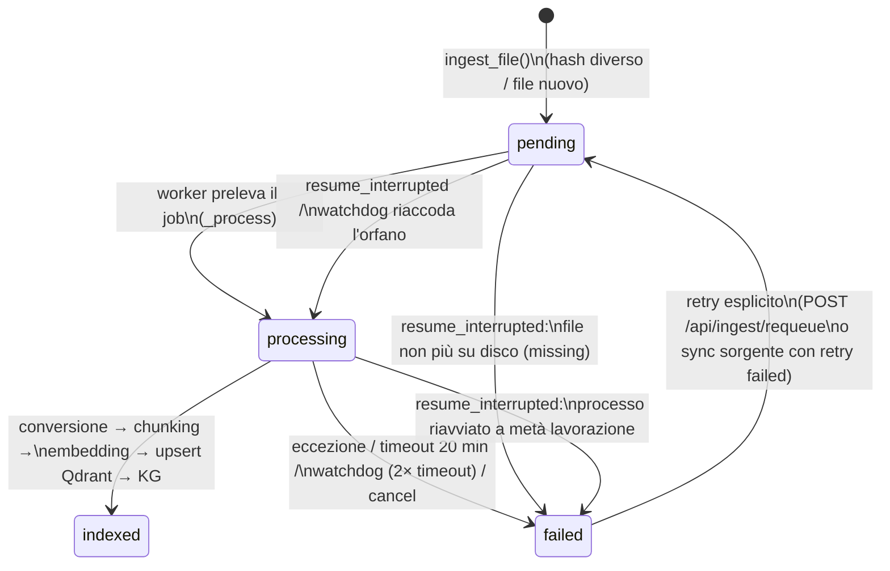

# 03 — Pipeline di indicizzazione dei documenti

Deep-dive tecnico sulla pipeline di ingestion di Virtualis: dal file sorgente
(connettore, upload, import M365) ai punti in Qdrant e al knowledge graph.
Riferimenti principali del codice:

- `backend/app/ingestion/pipeline.py` — coda, worker, watchdog, ciclo di vita
- `backend/app/ingestion/converter.py` — conversione Docling in `NormalizedDoc`
- `backend/app/ingestion/convert_worker.py` — sottoprocesso isolato di conversione
- `backend/app/ingestion/chunker.py` — chunking gerarchico struttura-aware
- `backend/app/ingestion/embeddings.py` — embedding densi + sparsi (fastembed)
- `backend/app/ingestion/indexer.py` — facade su Qdrant (upsert/delete)
- `backend/app/reindex.py` — reindicizzazione completa dell'indice vettoriale
- `backend/app/connectors/{base,local_fs,gdrive,m365,upload}.py` — sorgenti
- `backend/app/m365_import.py` — job di import completo da Microsoft 365
- `backend/scripts/{reindex,kg_build}.py` — operazioni da riga di comando

---

## 1. Ciclo di vita di un documento

Gli stati sono i valori dell'enum `DocumentStatus` (`backend/app/models.py:32`):
`pending`, `processing`, `indexed`, `failed`. La riga `Document` nel DB SQLite
è la fonte di verità; la coda di lavorazione vive solo in memoria
(`_PipelineState` in `pipeline.py:57`).

Le transizioni rilevanti:

- **Registrazione (`ingest_file`, `pipeline.py:116`)**: calcola lo SHA-256 del
  contenuto (`content_hash`, `pipeline.py:74`, lettura a blocchi da 1 MiB in
  thread separato), cerca la riga per `(source_id, external_id)` e:
  - se esiste già con lo **stesso hash** e status `indexed` → **skip** (dedup):
    ritorna l'id esistente e registra l'esito `skipped` in `_state.recent`;
  - altrimenti crea/aggiorna la riga con status `pending`, `error = None`,
    e accoda un `_Job(document_id, path)` in `_state.queue`.
- **Lavorazione (`_process`, `pipeline.py:186`)**: status `processing`, poi la
  catena completa (§2). In caso di successo: status `indexed` + `page_count`.
  In caso di eccezione: status `failed` con `error` **sanitizzato** (§3.5).
  Una `asyncio.CancelledError` (timeout del worker o shutdown) è trattata come
  fallimento: `error = "Lavorazione interrotta (timeout o arresto)"`.
- **Timeout di lavorazione (`_worker_loop`, `pipeline.py:367`)**: ogni job è
  avvolto in `asyncio.wait_for(_process(...), timeout=_PROCESS_TIMEOUT_S)` con
  `_PROCESS_TIMEOUT_S = 20 * 60` (20 minuti). Allo scadere il documento è
  marcato `failed` con errore `"Timeout di lavorazione (20 min)"` e il worker
  sopravvive e passa al job successivo.
- **Nessuna transizione automatica da `failed`**: un documento `failed` resta
  tale finché non interviene un'azione esplicita (§4.4).

---

## 2. Gli stadi della pipeline in dettaglio

L'ordine esatto eseguito da `_process` è: conversione → rimozione vecchi chunk
→ chunking → righe `Chunk` nel DB → embedding → upsert Qdrant → commit finale
→ estrazione KG.

### 2.1 Dedup via content_hash

La deduplicazione è sul **contenuto**, non sul nome: `ingest_file` confronta
lo SHA-256 appena calcolato con `Document.content_hash` e salta l'ingest solo
se il documento è anche `indexed`. Conseguenze:

- lo stesso file re-importato (sync periodica, re-upload) non costa nulla;
- un file **modificato** (hash diverso) riparte da `pending` e viene
  completamente reindicizzato (i vecchi chunk sono eliminati allo stadio 2);
- un file fallito in precedenza (status `failed`) NON è protetto dalla dedup:
  un nuovo `ingest_file` sullo stesso `(source_id, external_id)` lo riaccoda
  — è questo il meccanismo usato dal retry dei connettori.

### 2.2 Conversione (`converter.py`)

`convert_document(path, doc_meta=...)` produce un `NormalizedDoc`: lista piatta
di `Block` (`kind` ∈ `heading | paragraph | table | list_item | caption`, con
`level`, `page`, `section_path`, `bboxes`) + metadati (`title`, `author`,
`modified_at`, `doc_type`, `page_count`).

- **Testo semplice**: `.md`, `.markdown`, `.txt` (`_PLAIN_EXTENSIONS`) sono
  letti direttamente, senza avviare Docling, con parsing minimo dei heading
  Markdown (`#`–`######`) e fallback di encoding UTF-8 → latin-1. Il titolo è
  il primo heading di livello 1, se presente.
- **Tutto il resto via Docling**: PDF, DOCX, XLSX, PPTX, HTML, immagini.
  `iterate_items()` percorre il documento in ordine di lettura; i label Docling
  sono mappati così: `title`/`section_header` → heading, `list_item` →
  list_item, `caption` → caption, `table` → table (serializzata in **Markdown**
  via `export_to_dataframe`, preservando righe e colonne), `text`/`paragraph`
  → paragraph. `page_header`, `page_footer`, `picture`, `formula` ecc. sono
  ignorati. Per i PDF i `prov` di Docling danno anche numero di pagina e
  **bbox** (punti PDF, origine bottom-left, con `page_width`/`page_height`
  quando disponibili — servono al viewer per l'evidenziazione delle citazioni).
- **OCR (opzionale, `ocr_enabled`, default off)**: Tesseract via CLI
  (`TesseractCliOcrOptions`, lingue `ita` + `eng`). Sempre attivo per le
  immagini (`.png .jpg .jpeg .tiff .tif .bmp`); per i PDF solo come seconda
  passata quando il testo nativo medio è sotto `_OCR_MIN_CHARS_PER_PAGE = 100`
  caratteri/pagina (tipico delle scansioni).
- **Export dei Google Docs nativi**: non avviene nel converter ma nel
  connettore (§5.3): Docs/Sheets/Slides sono esportati da Drive come
  DOCX/XLSX/PPTX e poi convertiti normalmente.
- **Errori**: qualunque fallimento è rilanciato come `ConversionError` con un
  messaggio pensato per l'utente (es. `"File non trovato: nome.ext"`,
  `"Impossibile convertire nome.ext: ..."`) — solo il nome file, mai il path
  completo.
- I metadati finali sono risolti con precedenza: override del connettore
  (`doc_meta`) → metadati Docling → filesystem (mtime, stem).

### 2.3 Rimozione della versione precedente

Prima del re-ingest, `_process` elimina:

- i punti Qdrant del documento (`index.delete_document`, filtro sul payload
  `document_id`);
- le righe `Chunk` nel DB (`delete(Chunk).where(document_id == ...)` — la
  rimozione è esplicita perché `document.chunks.clear()` farebbe lazy loading,
  vietato nel contesto async di SQLAlchemy);
- mention/relazioni del knowledge graph (`delete_document_graph`).

### 2.4 Chunking (`chunker.py`)

`chunk_document(norm, target_tokens=512, overlap_tokens=64)` — i default sono
`chunk_target_tokens` / `chunk_overlap_tokens` in `config.py:137-138`. Regole:

- **Confini di sezione inviolabili**: i blocchi sono raggruppati per
  `section_path`; un heading chiude sempre il segmento corrente. L'overlap
  vale solo tra chunk della stessa sezione.
- **Conteggio token**: tiktoken `cl100k_base` (caricato lazy); selezionabile
  `token_method="approx"` (stima `chars/4`, fallback anche in caso di errore
  di tiktoken).
- **Limite verificato sul testo completo** (prefisso sezione + corpo), non
  sulla somma dei pezzi: gli arrotondamenti non fanno sforare il target.
- **Split a frasi** (regex su punteggiatura forte), mai a metà parola; una
  frase singola più lunga del budget (`max(target - prefix, target // 2)`) è
  spezzata per parole.
- **Overlap a frasi intere**: alla chiusura di un chunk si riusano le ultime
  frasi entro `overlap_tokens` come testa del successivo; se l'overlap stesso
  fa sforare, si riparte da zero.
- **Tabelle**: ogni tabella è un chunk dedicato (`kind="table"`), mai spezzata
  (può superare il target: segnalato in log), con prefisso in linguaggio
  naturale `"Tabella nel documento «titolo», sezione «...»"` per renderla
  raggiungibile dalle query.
- **Prefisso di sezione**: ogni chunk testuale inizia con
  `"[Sezione: A > B > C]\n\n"`.
- **`context_text`**: finestra estesa (chunk ± 1 adiacente, budget ~2× target)
  usata in retrieval per dare più contesto al LLM; salvata in DB e nel
  payload Qdrant.
- **Bbox**: i rettangoli dei blocchi che compongono il chunk sono uniti e
  deduplicati (`_merge_bboxes`) per l'evidenziazione multi-rettangolo;
  `page_start`/`page_end` sono min/max delle pagine dei pezzi.

### 2.5 Embedding (`embeddings.py`)

Modelli esatti (default in `config.py:54-55`):

- **Denso**: `intfloat/multilingual-e5-large` (fastembed, ONNX locale). La
  famiglia E5 richiede prefissi: `"passage: "` per i documenti
  (`embed_passages`), `"query: "` per le query (`embed_queries`). Mai usare
  l'embedding grezzo.
- **Sparso**: `Qdrant/bm25` (BM25, nessun prefisso). Produce
  `{"indices": [...], "values": [...]}` pronti per i vettori sparsi Qdrant.

I pesi sono scaricati da HuggingFace al primo uso (una tantum, con log) e
tenuti in cache da fastembed; `Embedder` è un singleton lazy (`Embedder.get()`).

**Testo embeddato — `build_passage_text(title, text)`** (`embeddings.py:84`):
il testo indicizzato (denso E sparso) è `"titolo\n" + testo_chunk`. Il titolo —
che per local_fs e M365 contiene il **percorso relativo**
("Cartella/Sotto/file") — aggancia al contesto i chunk "muti" (es. tabelle di
soli MAC address in una planimetria) anche in BM25. Il titolo è normalizzato
su una riga e troncato a `TITLE_TOKEN_BUDGET = 40` token (silenziosamente). Il
prefisso `"passage: "` è aggiunto dopo da `embed_passages`. **Payload Qdrant e
DB conservano il testo pulito**: citazioni e snippet sono invariati.

**Budget di troncamento**: `EMBED_TOKEN_BUDGET = 552` token cl100k (= 512 del
chunk al target + 40 del titolo), scelto perché il limite reale dell'e5 è 512
token del suo tokenizer XLM-R (~507 di contenuto) e il rapporto
token-e5/cl100k misurato è ~0,76 su prosa italiana (~0,95 nel caso peggiore
tabellare): un chunk standard con titolo non è mai pre-troncato; il
troncamento esplicito (`truncate_for_embedding`, ricerca binaria sulle parole
con warning in log) resta per i chunk fuori misura, es. tabelle mantenute
intere.

Gli embedding densi e sparsi sono calcolati in parallelo (`asyncio.gather` di
due `asyncio.to_thread`, batch 32).

### 2.6 Upsert Qdrant (`indexer.py`)

- Connessione: server remoto se `qdrant_url` è valorizzato, altrimenti
  **Qdrant embedded** su file in `data_dir/qdrant`; in embedded gli accessi
  sono serializzati con un `asyncio.Lock` (il local-mode non tollera accessi
  concorrenti né un secondo processo sullo stesso path).
- Collection (`qdrant_collection`, default `"chunks"`): vettori named
  `dense` (cosine) + `sparse` (con `Modifier.IDF`). Il denso usa
  **quantizzazione scalare int8** (`quantile=0.99`, `always_ram=True`): ~4×
  meno RAM con perdita trascurabile sul ranking; si applica solo alle
  collection create da ora in poi.
- **Id dei punti**: UUID5 deterministico da `(document_id, ord)` con
  namespace fisso (`point_id`, `indexer.py:36`) → gli upsert sono idempotenti.
- **Payload**: `document_id`, `chunk_id` (id della riga DB), `ord`, `text`,
  `context_text`, `section_path`, `page_start`, `page_end`, `bboxes`, più i
  metadati del documento (`title`, `source_id`, `source_name`, `doc_type`,
  `author`, `modified_at` come epoch). L'upsert del client sincrono gira in
  thread, sotto lock.
- `delete_document(document_id)` rimuove per filtro `MatchValue`;
  `delete_documents(list)` (usata dal reset admin) usa `MatchAny` in batch.

### 2.7 Estrazione knowledge graph inline

Se `kg_enabled` (default `False` in config; attivo in produzione), dopo il
commit `indexed` la pipeline chiama `extract_for_document` (modulo
`app/knowledge/extractor.py`) col client LLM condiviso: il testo del documento
è troncato a `kg_max_chars_per_doc` (default 12000 caratteri) e passato al
LLM in JSON mode per entità e relazioni (tetto `kg_max_entities_per_doc = 40`
entità). È **best-effort**: qualunque fallimento è solo loggato
(`"estrazione knowledge graph fallita (ingest comunque riuscito)"`) e lo
status resta `indexed`. Nota operativa: le chiamate LLM passano dal semaforo
`llm_max_concurrency` (default 2) perché Ollama serve in serie.

---

## 3. Isolamento di memoria: il convert_worker

### 3.1 Perché un sottoprocesso

La conversione Docling di documenti patologici (planimetrie raster, PDF
enormi) può superare il `mem_limit` del container: l'OOM killer del cgroup
ucciderebbe l'**intero** processo Python dell'app, abbattendo anche job in
corso e code (tre incidenti reali il 24/08 durante l'import M365). Con
`convert_in_subprocess = True` (default, `config.py:144`) la conversione gira
in un processo figlio: il documento patologico fallisce **da solo** e l'app
resta in piedi.

### 3.2 Architettura

- Un unico figlio **persistente** (la pipeline è seriale), creato col context
  multiprocessing **`spawn`** — niente `fork` con asyncio — con `daemon=True`
  (se l'app muore, il figlio muore con lei) e nome `"virtualis-convert"`.
  Persistente perché Docling carica modelli pesanti al primo uso: un processo
  nuovo per documento pagherebbe il caricamento ogni volta.
- Comunicazione via `Pipe` con messaggi `("convert", path, doc_meta)` →
  `("ok", NormalizedDoc)` oppure `("error", messaggio)`. `NormalizedDoc` è una
  dataclass di soli tipi base (picklabile) e attraversa la pipe direttamente.
- Avvio **lazy** alla prima richiesta; il padre è chiamato fuori dall'event
  loop (`asyncio.to_thread` in `pipeline.py:217`) con il timeout della
  pipeline (`_CONVERT_TIMEOUT_S = _PROCESS_TIMEOUT_S - 2*60`, cioè 18 minuti:
  sotto il timeout complessivo così il fallimento arriva pulito dal worker
  invece che dal `wait_for` esterno).

### 3.3 RLIMIT_AS: VAS contro RSS

Il figlio applica `resource.setrlimit(RLIMIT_AS, ...)` con
`convert_max_memory_mb` (default 6144 MB; **24576 nel compose di produzione**:
coi modelli di layout/OCR caricati lo spazio degli indirizzi supera i 16 GB
anche su scansioni piccole). Distinzione fondamentale:

- **VAS (Virtual Address Space)**: è ciò che `RLIMIT_AS` limita — l'intero
  spazio di indirizzamento virtuale, incluse le riservazioni mai toccate.
  Allocatori come quelli di torch/onnx riservano molto più di quanto usano:
  per questo il limite è alto e oltre soglia si ottiene `MemoryError` (o
  fallimento dei `malloc` nativi, `std::bad_alloc`) **nel figlio**, non
  l'OOM killer sull'app.
- **RSS (Resident Set Size)**: la memoria fisica effettivamente occupata.
  `RLIMIT_AS` non la limita: la rete di sicurezza per la RSS resta il
  `mem_limit` del container (in produzione alzato a 20g per il processo
  principale, che parte già da ~12 GB tra modelli retrieval e Qdrant
  embedded).
- Su macOS la chiamata riesce ma il kernel non la applica — accettabile: la
  produzione è Linux.

### 3.4 Crash, timeout e riciclo

- **Morte del figlio** (OOM, segfault): emerge come `EOFError` dalla `recv`
  (`poll()` torna True anche a pipe chiusa) → `_WorkerCrashedError` → il padre
  scarta il worker e solleva `ConversionError(MEMORY_ERROR_MESSAGE)`:
  `"Conversione interrotta: limite di memoria superato (file troppo
  complesso)"`. Alla richiesta successiva il figlio è ricreato.
- **Timeout della richiesta** (`poll(timeout)` scade): `_WorkerTimeoutError`
  → worker terminato e ricreato, `ConversionError("Conversione interrotta:
  tempo massimo superato (N s)")`.
- **Riciclo periodico**: ogni `convert_worker_max_tasks` conversioni (default
  **8**; 0 = mai) il figlio è distrutto e ricreato, perché torch/Docling non
  restituiscono la RSS al sistema e sotto carico il container andrebbe contro
  il `mem_limit`. Il costo è il reload dei modelli una volta ogni N documenti.
- **Nel figlio**: `MemoryError` durante la conversione o durante la
  serializzazione della risposta (`_safe_send`, con `gc.collect()`) degrada a
  `("error", MEMORY_ERROR_MESSAGE)` invece di morire col risultato a metà;
  un `ConversionError` passa col suo messaggio; qualunque altra eccezione è
  convertita in errore pulito — il loop del figlio deve sopravvivere.
- **Hook di test**: le variabili `_VIRTUALIS_TEST_CONVERT_EXIT` (il figlio fa
  `os._exit(137)`, come un SIGKILL dell'OOM killer) e
  `_VIRTUALIS_TEST_CONVERT_SLEEP_S` simulano deterministicamente morte e
  lentezza: le monkeypatch non attraversano il confine di processo.

### 3.5 Errori pubblici contro log

`_public_error` (`pipeline.py:83`) decide cosa finisce nel campo `error` del
documento (visibile via API): solo `ConversionError` e
`ConnectorNotConfiguredError` passano col loro messaggio (già pensato per
l'utente); tutto il resto diventa
`"Errore interno durante l'indicizzazione (<TipoEccezione>)"`, perché
`str(exc)` può contenere path interni o dettagli d'infrastruttura. L'errore
completo resta sempre nel log structlog.

---

## 4. Affidabilità

### 4.1 Coda in memoria

`_PipelineState` (`pipeline.py:57`) tiene: `queue` (`asyncio.Queue[_Job]`),
`pending` (document_id → titolo), `processing` + `processing_since`
(monotonic), e `recent` (deque di 50 esiti). Il worker è **uno per processo**,
avviato nel lifespan dell'app (`start_worker`), che prepara anche la
collection Qdrant. La pipeline è quindi **strettamente seriale**: un documento
alla volta.

### 4.2 Shutdown

`stop_worker()` cancella worker e watchdog **senza** attendere lo svuotamento
della coda: con migliaia di documenti accodati un `queue.join()` terrebbe il
processo in vita per ore fino al SIGKILL dell'orchestratore. I documenti non
processati (rimasti `pending`/`processing` nel DB) sono ripresi al riavvio.

### 4.3 resume_interrupted

Chiamata nel lifespan e dalla route `POST /api/ingest/requeue`
(`pipeline.py:561`):

- i `pending` sono riaccodati ritrovando il file per **path diretto**
  (`external_id` che punta a un file esistente, tipico di upload/local_fs)
  oppure per **content_hash** tra i file di `upload_dir` (utile dopo uno
  staging rinominato);
- un `pending` il cui file **non esiste più** diventa `failed` con errore
  `"File non più disponibile sul disco: da risincronizzare la sorgente o
  ripetere l'import"` — mai lasciato congelato: la sync della sorgente lo
  riscaricherà col retry dei failed;
- i `processing` diventano `failed` (`"Lavorazione interrotta dal riavvio del
  servizio"`): erano in lavorazione quando il processo è morto e sono i primi
  sospetti in caso di crash nativo — NON riaccodati automaticamente;
- ritorna `{"requeued", "marked_failed", "missing"}`.

### 4.4 Perché i failed non ripartono mai da soli

I `failed` restano `failed`: sono riaccodati **solo** con
`resume_interrupted(..., include_failed=True)`, invocato esclusivamente dalla
route admin `/api/ingest/requeue`. Mai all'avvio: un lotto di fallimenti
sistematici (es. 50 PDF corrotti) rilavorato a ogni riavvio brucerebbe ore di
lavorazione inutile. Eccezione by design: il **connettore gdrive** ritenta i
propri failed a ogni sync richiesta (§5.3).

### 4.5 Watchdog (`_watchdog_loop`, `pipeline.py:426`)

Gira ogni `_WATCHDOG_INTERVAL_S = 60` secondi; ogni tick è protetto da try/except
(un errore non gestito non uccide il watchdog). Tre compiti:

1. **Rianima il worker morto**: se `_worker_task` è `None` o `done()`, logga
   la causa (cancellato / eccezione) e lo riavvia con `start_worker`.
2. **Sblocca lavorazioni oltre 2× il timeout**: se `processing` dura da più di
   `_PROCESS_TIMEOUT_S * 2` (40 min) significa che il `wait_for` del worker non
   è scattato (loop bloccato altrove, es. wedge nativo): il worker è
   cancellato e ricreato, il documento marcato `failed` con `"Lavorazione
   bloccata: interrotta dal watchdog"`.
3. **Riaccoda i pending orfani**: se nessun documento è in lavorazione e il
   numero di `pending` nel DB supera `queue.qsize()`, incrementa un contatore
   di strike; solo dopo `_WATCHDOG_ORPHAN_STRIKES = 2` giri consecutivi chiama
   `resume_interrupted`. Il doppio strike è antirumore: `ingest_file` scrive
   prima il DB e poi accoda, e il watchdog non deve duplicare un job in
   quella finestra.

Nato dall'incidente del 26-27/08 (coda gdrive congelata due volte con decine
di pending e worker morto in silenzio).

---

## 5. Connettori

### 5.1 Contratto (`connectors/base.py`)

Un `Connector` riceve `config` (da `Source.config_json`; se mancano le
credenziali solleva `ConnectorNotConfiguredError` alla costruzione) e sa fare:

- `enumerate() -> list[RemoteItem]` — elenca gli elementi remoti
  (`external_id` stabile, `title`, `modified_at`, `size`, `meta`);
- `fetch(item) -> Path` — rende l'elemento un file locale (download in
  `upload_dir/staging`, o path originale se già locale);
- `changes(state) -> (items | Tombstone, new_state)` — variazioni rispetto
  allo stato persistito in `Source.state_json`; il default è scan completo
  (il diff per content hash resta al chiamante), i connettori con API delta
  lo sovrascrivono;
- `sync(source, session_factory) -> report` — non è nel contratto astratto ma
  è il metodo che le route invocano: orchestra enumerate/changes → fetch →
  `pipeline.ingest_file` → cancellazioni (tombstone → `delete_document` +
  rimozione riga Document, con cascade dei chunk e pulizia del KG).

### 5.2 local_fs (`local_fs.py`)

Per cartelle locali o NAS/SMB montati sull'host (in produzione la share
`//<server-smb>/IA-LOCALE` montata read-only e bindata nel container).
Config: `{"path": "...", "glob": "**/*"}`. Scansione ricorsiva limitata a
`SUPPORTED_EXTENSIONS` (pdf, docx, xlsx, pptx, html/htm, md/markdown, txt,
png, jpg/jpeg, tiff/tif, bmp, asciidoc). Il **titolo è il percorso relativo
senza estensione** ("Cartella/file") — conserva la struttura delle
sottocartelle. `fetch` non copia nulla: usa il path originale.

La sync confronta il content hash:

- file nuovo o hash diverso → ingest;
- stesso hash su path diverso → **rinomina**: aggiorna `external_id`/titolo
  senza reindicizzare;
- file sparito → cancellazione da indice, DB e KG.

**Guardia anti-svuotamento**: se la scansione non trova nulla ma il DB ha
documenti, la sync si rifiuta (mount di rete non disponibile?) invece di
cancellare l'intero indice della sorgente. Report: `scanned`, `ingested`,
`renamed`, `unchanged`, `deleted`, `errors`.

### 5.3 gdrive (`gdrive.py`)

Service account con scope `drive.readonly`; config `credentials_json` +
opzionalmente `folder_id` o `shared_drive_id`. Dipendenze opzionali
(extra `gdrive`), import lazy: il connettore è istanziabile anche senza.

- **Enumerazione**: con `folder_id` è ricorsiva (BFS) e i titoli conservano il
  percorso relativo; senza, listing piatto su `corpora="allDrives"` (o
  `corpora="drive"` con `shared_drive_id`), sempre con
  `supportsAllDrives=True` / `includeItemsFromAllDrives=True`.
- **Export Google nativi**: Docs/Sheets/Slides → DOCX/XLSX/PPTX
  (`_GOOGLE_EXPORTS`); gli altri file sono scaricati così come sono in
  `upload_dir/staging` con nome UUID.
- **Changes API**: senza `folder_id`, `changes()` usa il `pageToken`
  persistito in `Source.state_json` (`page_token`): al primo giro prende lo
  `startPageToken` e fa scan completo; poi restituisce item
  nuovi/modificati e `Tombstone` per `removed: true` o `trashed`. Con
  `folder_id` la Changes API non è filtrabile per cartella → scan completo.
- **Skip per modifiedTime**: se il documento è `indexed` e `modifiedTime` è
  invariato, il download è evitato (oltre alla dedup per hash della pipeline).
- **Retry dei failed** (`retried_failed`): in modalità delta la Changes API
  non restituisce i file falliti (nessun cambiamento remoto) e resterebbero
  `failed` per sempre. La sync ritenta **sempre** i `failed` della sorgente
  non già coperti dallo scan, con metadati freschi via `files().get` (così
  funziona anche l'export dei Google Docs nativi); il report espone
  `retried_failed`. Se il problema è permanente tornano failed senza loop: il
  retry parte solo a sync esplicitamente richiesta.
- Guardia anti-svuotamento come local_fs (condivisioni/credenziali revocate?).

### 5.4 m365 — connettore delta (`m365.py`)

Connettore per **un singolo drive** SharePoint/OneDrive via Graph API (extra
`m365`, MSAL + httpx). Config: `tenant_id`, `client_id`, `client_secret`,
`drive_id`. Auth client-credentials (scope `.default`, cache token MSAL).
Enumerazione ricorsiva di `/drives/{id}/root/children`; `changes()` usa
`/root/delta` con `deltaToken` persistito (`delta_link` in
`Source.state_json`), tombstone per i nodi con facet `deleted`. Download in
streaming (blocchi da 1 MiB) in `upload_dir/staging`.

### 5.5 Import M365 completo (`m365_import.py`)

Job separato (route `/api/m365/*`, uno alla volta, in memoria: un riavvio
dell'app lo uccide e va rilanciato) che scarica **tutto** il tenant:
OneDrive di tutti gli utenti (o lista `users` esplicita di UPN, o singolo
`user`), tutti i siti SharePoint con i loro drive, e tutta la posta (messaggi
come `.md` con intestazioni + corpo HTML→testo, allegati come file separati).

- **Fasi**: auth → scan → download → attesa ingest (fase `ingest`: polling
  degli status della sorgente finché pending+processing = 0 per 3 giri).
- **Auth**: `client_credentials` (consigliata), `password` (ROPC, bloccata da
  MFA), `device_code` (MFA-compatible, refresh token riutilizzabile nello
  stato del flusso). Errori Entra ID tradotti in indicazioni operative
  (AADSTS50076/50079 → MFA, AADSTS7000218 → public client).
- **Scoping**: opzione `folders` (formato `"upn:/percorso"`, validata da
  `parse_folder_spec`): lo scan OneDrive parte solo dalle cartelle date
  (risolte via `/users/{upn}/drive/root:/percorso:`), gli altri utenti/drive
  non sono toccati; mail e SharePoint restano governate da
  `include_mail`/`include_sharepoint`. Opzione `max_file_mb` (default 50):
  i file oltre soglia sono saltati e conteggiati in `skipped_files`
  (log aggregato ogni 25).
- **Scan**: BFS con pool di `_SCAN_WORKERS = 8` worker; dedup
  `driveId:itemId` (Graph può restituire duplicati in paginazione);
  esclusione di `_EXCLUDED_DIR_NAMES` (node_modules, .git, venv, bin, ...);
  gestione degli elementi **condivisi** (`remoteItem`: la ricorsione prosegue
  sul drive del proprietario). Modalità opzionale `scan_mode="search"` (search
  Graph per estensione: veloce ma dipendente dall'indice di ricerca).
- **Robustezza**: retry/backoff su 429/5xx onorando `Retry-After` fino a
  120s; guardia disco (sotto `_MIN_FREE_BYTES = 5 GiB` l'import si interrompe
  per sicurezza); le credenziali non sono mai persistite.
- Ogni file scaricato entra nella pipeline standard con sorgente "Microsoft
  365": `external_id` = `m365://<categoria>/<id>#<nomefile>` (il nome su disco
  dopo `#` rende i file ritrovabili dopo un riavvio a metà ingest); titolo =
  percorso relativo per i drive, `"Email: <oggetto>"` per la posta.

### 5.6 Upload manuale (`upload.py`)

`save_upload()` salva il file in `upload_dir` con nome sicuro
(`<uuid4><estensione sanitizzata>`, mai il nome del client), sulla sorgente
"upload" di default (creata al primo uso) e chiama `ingest_file` con titolo =
nome originale senza estensione. Limite `upload_max_mb = 50` applicato dalla
route.

---

## 6. Reindex completo (`reindex.py`)

**Quando serve**: dopo un cambio del formato del testo indicizzato (es.
l'introduzione di `build_passage_text` col titolo) o un cambio di modello di
embedding, per riallineare Qdrant **senza riconvertire i file sorgente**.

**Come funziona** (`ReindexJob`, route `POST /api/admin/reindex` + polling su
`/api/admin/reindex/status`):

- enumera tutti i documenti `indexed` e per ciascuno ri-embedda i chunk
  **dal DB** (sola lettura su SQLite) con `build_passage_text(titolo, testo)`,
  poi `delete_document` + `upsert_chunks` con gli stessi id deterministici;
- batch da `_EMBED_BATCH = 200` chunk (limita RAM e round-trip);
- **stato su file**: l'ultimo `document_id` completato è salvato in modo
  atomico (write + rename) in `data_dir/reindex_state.json`; una nuova
  esecuzione riparte da lì, `restart=true` lo ignora; a lavoro completato il
  file è rimosso (i documenti falliti si rilavorano con `restart=true`);
- **precedenza all'ingest**: se la coda di ingestion ha pending/processing il
  job si mette in pausa (`paused_for_ingest`, controllo ogni 15s) e riprende
  a coda vuota;
- errori per-documento: log e si prosegue (`failed_documents`); gli stati del
  job sono `idle | running | done | failed | cancelled`;
- usa l'indice e l'embedder **già inizializzati** dell'app: il client Qdrant
  local-mode non tollera un secondo processo sullo stesso path, quindi niente
  script standalone.

**Script CLI**: `backend/scripts/reindex.py` è solo un client HTTP della
route (login, avvio, polling con percentuale/chunk/s/ETA, summary finale);
pensato per girare nel container o via nohup sull'host. Interromperlo non
ferma il job nell'app.

**Knowledge graph**: il reindex NON tocca il KG. Per (ri)costruirlo sul
corpus già indicizzato c'è `backend/scripts/kg_build.py`: estrazione per
tutti i documenti `indexed` (o `--document-id N`), una chiamata LLM per
documento troncata a `kg_max_chars_per_doc`; richiede la chiave LLM
configurata (exit code 2 se assente, 1 con estrazioni fallite). Serve perché
`kg_enabled` è `false` di default: si può attivare dopo e popolare il grafo
senza reindicizzare.

---

## 7. Prestazioni e limiti noti

- **Serialità**: un solo documento alla volta (un worker, una coda). La
  conversione è il collo di bottiglia (Docling, a volte OCR); embedding e
  upsert sono in batch. Il parallelo esiste solo a monte (scan M365 con 8
  worker, download concorrenti nel job) e a valle (denso+sparso in parallelo).
- **Memoria del processo principale**: parte da ~12 GB di RSS (modelli
  retrieval + Qdrant embedded) e cresce durante l'ingest perché torch/onnx
  non rilasciano; il `mem_limit` del container è la rete di sicurezza RSS
  (in produzione 20g). Parametri di tuning: `convert_max_memory_mb` (VAS del
  figlio), `convert_worker_max_tasks` (riciclo RSS del figlio, default 8),
  `convert_in_subprocess` (spegnere solo per debug).
- **Timeout**: 20 min per documento (`_PROCESS_TIMEOUT_S`), 18 per la sola
  conversione (`_CONVERT_TIMEOUT_S`), watchdog su 2× (40 min). Documenti
  enormi/complessi possono superarli: vanno ritentati dopo tuning.
- **Dimensioni file**: `upload_max_mb = 50` per l'upload via API;
  `max_file_mb` (default 50) per l'import M365; per local_fs/gdrive non c'è
  tetto esplicito — il limite pratico è il timeout di lavorazione e la
  memoria del convert_worker. Due file grafici della share SMB falliscono in
  OOM in produzione: noto, accettato.
- **Coda non persistente**: un riavvio svuota la coda; i `pending` sono
  ripresi da `resume_interrupted` e dal watchdog, i `processing` diventano
  `failed`, i `failed` non ripartono da soli (tranne retry gdrive alla sync).
  Il job di import M365 vive in memoria: va rilanciato dopo un riavvio.
- **Qdrant embedded**: lock su file — un solo processo; per questo reindex e
  kg_build pilotano l'app viva o usano le sue sessioni, mai un secondo client
  sullo stesso path. La quantizzazione int8 del denso riduce ~4× la RAM dei
  vettori.
- **LLM in serie**: l'estrazione KG inline passa dal semaforo
  `llm_max_concurrency = 2` perché Ollama serve una richiesta alla volta: un
  ingest massiccio con KG attivo compete con la chat.
- **Graph throttling**: 429 con attese fino a 120s onorate; gli scan M365 su
  tenant grandi durano ore (mitigato da 8 worker e dalla modalità search).

---

## 8. Comportamenti garantiti dai test

### `backend/tests/test_pipeline.py`

| Test | Cosa asserisce |
|---|---|
| `test_ingest_markdown_end_to_end` | File `.md`: status `indexed`, chunk nel DB (ord, text, context_text, token_count) e numero di punti Qdrant uguale al numero di chunk |
| `test_ingest_docx_end_to_end` | `.docx` reale via Docling: `indexed`, `doc_type="docx"`, tabella e titolo di sezione presenti nei chunk |
| `test_reingest_identico_saltato` | Re-ingest dello stesso contenuto: stesso `document_id`, esito `skipped` in recent, nessun doppione in Qdrant (dedup content_hash) |
| `test_cancellazione_rimuove_punti` | `delete_document` azzera i punti Qdrant del documento |
| `test_pipeline_status` | `pipeline_status()` espone pending vuoto, processing `None`, ultimo esito `indexed` |
| `test_fallimento_a_meta_ingest_errore_sanitizzato_e_retry` | Fallimento a metà ingest: `failed` con errore **senza** path/dettagli interni (in recent e nel DB); ripristinato il componente, il re-ingest dello stesso file va a buon fine |
| `test_resume_interrupted_non_riaccoda_i_failed` | All'avvio: `pending` riaccodati, `processing` → `failed` ("interrotta"), i `failed` restano tali (stesso errore); con `include_failed=True` ripartono tutti |
| `test_resume_interrupted_pending_senza_file_diventa_failed` | `pending` senza file su disco → `failed` con "non più disponibile" (`missing=1`, `requeued=0`) |
| `test_watchdog_rianima_worker_morto_e_riaccoda_orfani` | Worker cancellato: il watchdog lo riavvia (tick 1) e dopo 2 strike riaccoda il `pending` orfano, che viene poi processato |
| `test_stop_worker_non_attende_lo_svuotamento_della_coda` | `stop_worker` con coda piena e lavorazione infinita termina entro 5s (niente join) |

### `backend/tests/test_convert_worker.py`

| Test | Cosa asserisce |
|---|---|
| `test_conversione_normale_e_worker_persistente` | Conversione corretta e stesso PID tra due richieste (figlio persistente, non uno spawn per documento) |
| `test_riciclo_worker_dopo_n_conversioni` | Con `CONVERT_WORKER_MAX_TASKS=2`: dopo 2 conversioni il worker è scartato e ricreato (PID diverso) |
| `test_errore_di_conversione_non_uccide_il_worker` | `ConversionError` dal figlio arriva pulita e il worker resta vivo e riusabile |
| `test_figlio_morto_a_meta_errore_pulito_e_ricreazione` | Figlio che muore a metà (hook `_VIRTUALIS_TEST_CONVERT_EXIT`): errore "limite di memoria", worker scartato, richiesta successiva su figlio nuovo |
| `test_timeout_richiesta_errore_pulito_e_ricreazione` | Richiesta oltre timeout (hook `SLEEP_S`): errore "tempo massimo", worker scartato e ricreato |
| `test_pipeline_ingest_via_worker` | Ingest end-to-end con `CONVERT_IN_SUBPROCESS=true`: documento `indexed` |
| `test_pipeline_documento_patologico_failed_e_pipeline_viva` | Il figlio muore sul documento patologico: solo quel documento è `failed` ("limite di memoria"), l'app resta viva e il documento successivo è `indexed` |
| `test_flag_off_percorso_in_process_invariato` | Con `CONVERT_IN_SUBPROCESS=false` la pipeline usa la conversione in-process e non tocca mai il worker |

### Altri test rilevanti

| Test | Cosa asserisce |
|---|---|
| `test_sync_riprova_documenti_failed` (suite connettore gdrive) | La sync gdrive ritenta i `failed` della sorgente anche in modalità delta, esponendo `retried_failed` nel report |

---

*Documento verificato sul codice al commit corrente del branch `main`.
Tutti i riferimenti a path, funzioni, costanti e valori di default sono presi
dai sorgenti elencati in testa; i valori di produzione citati (mem_limit,
timeout osservati, incidenti) provengono dalle note operative del progetto.*
